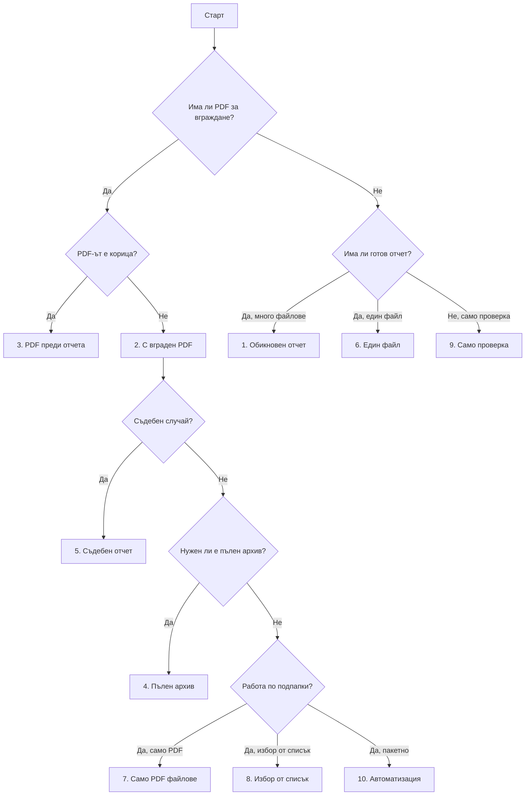

# Задълбочен анализ на GUI — ChronoSeal™ Enterprise v5.11.0-gui

**Статус: АНАЛИЗ + ЕМПИРИЧНА ПРОВЕРКА + ИЗПРАТЕНО УКРЕПВАНЕ + ИНТЕРАКТИВНО ШЛЮЗОВАНЕ (§10, §11, §12).**
Първоначалният одит беше само четене; впоследствие GUI-то беше реално стартирано и тествано
(§10), след което ограничен набор поправки беше приложен и валидиран (§11) — те са
основата на версия 5.11.0-gui. §12 описва шлюзоването на опциите зад чекбоксовете и
изтриването на трите дублиращи входа. Всичко по производствената логика остава непроменено.
Засегнати са следните файлове за четене:
`ChronoSeal_GUI.pyw`, `ChronoSeal_Original_Legacy.py`, `automation/File_Filter_Panel.py`,
`automation/Report_From_Files_Panel.py`, `automation/Start_Automation.py`,
`chronoseal/embed_options.py`, `chronoseal/settings.py`, `chronoseal/unified_theme.py`,
`config/config.json`, `config/ui.json`, `ui/index.html`, `ui/app.js`, `ui/style.css`, `package.json`.

**Цел на анализа:** оптимизация и превръщане на GUI в интерактивна среда, в която опциите
се прилагат лесно и бързо чрез чекбоксове, радио-бутони и select-и — **без промяна на основния
код и логика**.

**Съдържание:**

1. Обхват на проучването
2. Архитектура на GUI слоя
3. Инвентаризация на опциите (+ 3.1 дублиране)
4. Установени проблеми (4.1 – 4.3)
5. Предложение: интерактивна среда с чекбоксове
   - 5.1 Принципи · 5.2 Карта „Опции“ · 5.3 Матрица на зависимостите
   - **5.4 Лист с профили (5.4.1 – 5.4.6)** ← основната част
   - 5.5 Постоянни чекбоксове · 5.6 Sticky bar · 5.7 Единен Embed панел
   - 5.8 Inline валидация · 5.9 Клавиатура · 5.10 Уеб пропуски
6. Приоритетен план (всичко additive)
7. Рискове и ограничения
8. Заключение
9. Ограничения на одита
10. Емпирична проверка (реално стартиране и тестове)

**Виж също:** `docu/UNIFIED_GUI_START_HERE_BG.md` (кратък входен документ — описва 4 таба;
настоящият анализ документира **6** (`run_tab`, `report_files_tab`, `automation_tab`, `set_tab`,
`diag_tab`, `filter_tab`), тъй като е писан след добавянето на Report from Files и Selection).

---

## 1. Обхват на проучването

| Слой | Файлове | Роля |
|---|---|---|
| Desktop shell | `ChronoSeal_GUI.pyw` | Реалният единен интерфейс (`ChronoSealDesktop`) |
| Legacy база | `ChronoSeal_Original_Legacy.py` | Работещият оригинал — **не се променя** |
| Additive панели | `automation/File_Filter_Panel.py`, `Report_From_Files_Panel.py`, `Start_Automation.py` | Зареждат се през `SourceFileLoader` |
| Общи правила | `chronoseal/embed_options.py` | Единствен източник за тип отчет и вграждане |
| Настройки | `chronoseal/settings.py` | `load`/`save` през `atomic_json` |
| Тема | `chronoseal/unified_theme.py`, `chronoseal/branding.py` | Канонични PDF/UI токени |
| Конфигурация | `config/config.json`, `config/ui.json` | Runtime настройки |
| Web прототип | `ui/index.html`, `ui/app.js`, `ui/style.css` | Дизайн прототип, 7 страници |

---

## 2. Архитектура на GUI слоя

```
ChronoSeal_GUI.pyw  (ChronoSealDesktop)
   │
   ├── subclass на ChronoSeal_Original_Legacy.App        ← логиката остава непокътната
   │
   ├── ttk.Notebook с 6 скрити таба
   │      style.layout("Workspace.TNotebook.Tab", [])    ← табовете са невидими
   │      навигация: rail ttk.Button + Ctrl+1..6
   │
   ├── 01 Report & TSA        (_build_run_page)
   ├── 02 Report from Files   (ReportFilesPanel)
   ├── 03 Automation          (AutomationPanel)
   ├── 04 Settings & Trust    (_settings_ui + Canvas scroll hack)
   ├── 05 Diagnostics         (_diag_ui + rebind hack)
   └── 06 Selection           (FilterPanel)
              │
              └── _embed_state  (един споделен речник от Tk променливи)
                       │
                       └── chronoseal.embed_options.resolve_embed_options()
                                │
                                └── Pipeline.run
```

**Ключов извод:** архитектурата вече е правилна по същество.

- има **един** shared state (`_embed_state`);
- има **един** модул за правила (`embed_options.py`);
- панелите са **additive**, legacy прозорецът остава непроменен.

Проблемът **не е в логиката**, а в **подредбата и достъпността на опциите**.

---

## 3. Инвентаризация на опциите

Около **45 интерактивни контрола**, разпръснати в 6 страници и 2 модални прозореца.

| Страница | Чекбоксове | Радио | Combobox | Пътища / Entry | Действия |
|---|---|---|---|---|---|
| **01 Report & TSA** | подпапки, вграждане, изходна папка | преди/след | — | target, embed PDF, output dir | Generate, Cancel, PDF…, Report options…, Clear filters, Copy ×2 |
| **02 Report from Files** | вграждане | преди/след | — | evidence root | Add / Remove / Clear, Show in window, PDF embedding…, Check selection, Create, Hand over |
| **03 Automation** | — | — | вид отчет, режим | директория | Start, Show plan, Stop, Add / Remove / Clear files |
| **04 Settings** | архив включен | — | START / STOP пресет | archive dir, db, package, node, openssl, 2×URL, 2×certs | 2× Apply + долен ред |
| **05 Diagnostics** | — | — | — | — | Refresh, Open logs, Open evidence, Copy ×2 |
| **06 Selection** | — | — | — | папка | Clear, Copy list, Apply, Generate from selection + N филтърни реда |
| **Модал: PDF embedding** | вграждане | преди/след | — | PDF | PDF…, OK, Cancel |
| **Модал: Report options** | ERLAEUTERUNG, рекурсия, изходна папка | — | — | output dir | Browse, OK, Cancel |

### 3.1 Дублиране на опции

| Опция | Появява се в | Брой места |
|---|---|---|
| рекурсия (`rec`) | Run page + „Report options…“ диалог | **2** |
| позиция (`position`) | Run page + embed диалог + Report-from-Files | **3** |
| вграждане (`enabled`) | същите | **3** |
| изходна папка (`custom_output` + `output_folder`) | Run page + „Report options…“ | **2** |

Всички сочат към **една и съща** Tk променлива, така че няма разсинхронизация на данни.
Но операторът вижда „същата опция“ на 3 различни екрана и не знае кое е меродавното.

---

## 4. Установени проблеми

### 4.1 Структурни

1. **Разпиляна опция-повърхност.**
   Четири от най-важните превключватели (рекурсия, вграждане, позиция, изходна папка) живеят
   едновременно inline, в 2 модални диалога и на втора страница. Типичен run изисква
   **7–9 клика** и две отваряния на диалог.

2. **Вертикален стек без приоритет.**
   `_build_run_page()` подрежда 4 номерирани `LabelFrame`-а един под друг; primary действието
   `Generate report · Timestamp · Verify` е на дъното. При прозорец 1000×680 се налага скрол —
   **а Run page няма scroll host** (само Settings има).

3. **Scroll hack-ове.**
   Settings се нуждае от временно презаписване на `self.set_tab`, Diagnostics — на `self.diag_tab`,
   за да преизползва `_settings_ui()` / `_diag_ui()`. Работи, но е крехко и не бива да се
   преизползва за нови страници.

4. **`config/ui.json` пази само `{"language": "bg"}`.**
   Нито един чекбокс не се помни между сесиите → операторът отговаря на едни и същи въпроси
   всеки път.

5. **Automation: `mode_settings` се разрушава и пресъздава** при всяка смяна на режим → губи се
   състояние. Обратният превод `bg()` на локализирани етикети е чуплив при добавяне на трети език.

6. **Само Ctrl+1..6.**
   Няма access keys, няма Enter-за-старт, няма начин да се навигират опциите без мишка.

### 4.2 Визуални несъответствия

7. **Липсващи ttk стилове.**
   `_configure_enterprise_theme()` конфигурира около 25 стила, но **няма `TRadiobutton` и няма
   `Treeview`**. Следствие: всички радио-бутони (вграждане преди/след на 3 места) и **всички
   3 `Treeview`** (Selection preview, Report-from-Files, Show-in-window) излизат с default ttk
   вид — извън бранд палитрата.

8. **Web прототип: разминат accent.**
   `ui/app.js` → `initial.visual.accent = '#2878f6'`, а `ui/style.css` и `chronoseal/branding.py`
   дефинират `--accent: #1E64D6`. `applyTheme()` налага стойността от манифеста → уеб слоят се
   разминава с десктоп брандинга.

9. **Web прототип: мъртъв код.**
   `bindPage()` закача `$('#applyjson').onclick`, който чете `$('#manifestEditor').value` —
   **нито един от двата елемента не се рендерира** в designer шаблона. Импортът на манифест през
   редактор е неизползваем (файловият `#load` работи).

10. **`manifest.embed` се чете от preview, но липсва в `initial` схемата** → `undefined` при първо
    зареждане.

### 4.3 Несъответствие в обратната връзка

11. Legacy хвърля **модални `messagebox`** за грешки в опциите, докато новите панели публикуват
    **inline status label**. Двата канала съжителстват на един екран. Междувременно
    `_embed_selection()` вече има *non-raising* вариант, който връща `{'error': ...}` — готов е за
    inline показване, но не се използва навсякъде.

---

## 5. Предложение: интерактивна среда с чекбоксове

Предложението има **две ядра**:

1. **Една карта с чекбоксове** (т. 5.2 – 5.3) — подрежда разпръснатите контроли и показва само
   релевантните.
2. **Лист с профили** (т. 5.4) — превръща типичните комбинации в готови, именувани състояния,
   прилагани с един клик.

Двете се допълват: картата е за ръчна работа, листът — за повторяема работа.

### 5.1 Принципи

- **Нула промени в бизнес логиката.** Всичко ново е UI слой върху съществуващите Tk променливи.
- **Един източник на истина.** Нов компонент никога не създава паралелни `BooleanVar` /
  `StringVar` — свързва се към `_embed_vars()`, `self.rec`, `self.custom_output`,
  `self.output_folder`, `self.mode`.
- **Типът отчет се показва, не се изчислява.** Винаги през
  `chronoseal.embed_options.resolve_embed_options()` / `report_type_for()`.
- **Добавено, не пренаписано.** Нов панел се зарежда по вече установения модел
  `SourceFileLoader` + `spec_from_loader`, точно както `ReportFilesPanel` / `FilterPanel`.

### 5.2 Ядро: „Опции“ — една карта с чекбоксове вместо 4 екрана

Единна страница/панел с групирани карти, всяка карта = 1 решение:

```
┌─ ВХОД ────────────────────────────────────────────┐
│ [x] Включи подпапките      (активно само при папка)│
│     Обхват: 1 284 файла · 3 типа филтри  [Редакция]│
├─ PDF ВГРАЖДАНЕ ───────────────────────────────────┤
│ [ ] Вгради PDF                                     │
│     ( ) Преди отчета   (•) След отчета   [PDF…]   │
│     → избрано: deal.pdf                            │
├─ ОТЧЕТ ───────────────────────────────────────────┤
│ [ ] ERLAEUTERUNG страници                          │
│ [ ] Запази в друга папка   [път........]  [Browse] │
├─ РЕЗУЛТАТ (live read-back) ───────────────────────┤
│ COMBO_PDF · вграждане СЛЕД отчета · 1 PDF          │
└───────────────────────────────────────────────────┘
```

**Защо работи без промяна в логиката:** редът „РЕЗУЛТАТ“ вече съществува като
`ev['summary']` + `_sync_embed_summary()` + `summary_text()`. Новото е само **подредба и
enable/disable матрица**.

### 5.3 Матрица на зависимостите (само UI)

| Родител | Деца | Правило |
|---|---|---|
| `embed.enabled` | позиция, PDF път, Choose PDF | disabled, докато не е отметнато |
| `custom_output` | output entry, Browse | disabled, докато не е отметнато |
| target = файл | `rec` | disabled (вече частично през `_sync_input_mode`) |
| target празен | Generate | disabled + inline причина |
| `explanation` | — | самостоятелен |

Това е **най-голямата печалба за най-малко код** — операторът вижда само релевантните контроли.

### 5.4 Лист с профили (Profile Sheet) — 1 клик вместо 9

#### 5.4.1 Какво е профил

Профилът е **именуван набор от стойности на UI контроли** — нищо повече. Той не е нов път в
логиката: прилага се, като запише стойности в **вече съществуващите** Tk променливи
(`_embed_state['enabled'|'position'|'path']`, `self.rec`, `self.custom_output`,
`self.output_folder`, `self.mode`). След прилагане интерфейсът изглежда все едно операторът сам е
щракнал чекбоксовете.

**Пълен списък на полетата на профила (11 полета, всички UI-ниво):**

| # | Поле | Тип | Tk променлива, която пипа | Бележка |
|---|---|---|---|---|
| 1 | `recursive` | bool | `self.rec` | рекурсия в подпапки |
| 2 | `embed` | bool | `_embed_state['enabled']` | вграждане на PDF |
| 3 | `position` | `before`/`after` | `_embed_state['position']` | валидира се от `normalise_position()` |
| 4 | `explanation` | bool | `_embed_state['explanation']` | ERLAEUTERUNG страници |
| 5 | `custom_output` | bool | `self.custom_output` | „Запази в друга папка“ |
| 6 | `output_subdir` | str | `self.output_folder` | **само име на подпапка**, не абсолютен път |
| 7 | `mode` | `single`/`combined` | `self.mode` | производно от target, не се налага насила |
| 8 | `file_selection` | bool | `self.file_selection` | само избрани файлове |
| 9 | `filters` | list/`"keep"` | филтрите на Selection | `"keep"` = не пипай текущите |
| 10 | `archive` | bool | архивният чекбокс | само ако е разрешен в `config.json` |
| 11 | `start_page` | `01`..`06` | навигация | кой таб да е активен след прилагане |

Полета 6 и 9 са нарочно ограничени: профилът **никога не записва абсолютни пътища** и
**никога не изтрива филтри**, освен ако не е изрично зададено.

#### 5.4.2 Листът с профилите — системни (вградени, само за четене)

| Профил | Рекурсия | Вграждане | Позиция | ERLAEUT. | Собств. папка | Режим | Избор | Стартова стр. |
|---|:--:|:--:|---|:--:|---|---|:--:|---|
| **1. Обикновен отчет** | ✗ | ✗ | after | ✗ | ✗ | auto | ✗ | 01 |
| **2. С вграден PDF** | ✗ | ✓ | **after** | ✗ | ✗ | auto | ✗ | 01 |
| **3. PDF преди отчета** | ✗ | ✓ | **before** | ✗ | ✗ | auto | ✗ | 01 |
| **4. Пълен архив** | ✓ | ✓ | after | ✓ | ✓ | combined | ✗ | 01 |
| **5. Съдебен отчет** | ✗ | ✓ | after | **✓** | ✓ | combined | ✗ | 01 |
| **6. Един файл** | ✗ | ✗ | after | ✗ | ✗ | **single** | ✗ | 01 |
| **7. Само PDF файлове** | ✓ | ✗ | after | ✗ | ✗ | auto | ✗ | **06** |
| **8. Избор от списък** | ✗ | ✗ | after | ✗ | ✗ | combined | **✓** | **02** |
| **9. Само проверка** | ✗ | ✗ | after | ✗ | ✗ | auto | ✗ | **05** |
| **10. Автоматизация** | ✓ | ✓ | after | ✗ | ✗ | combined | ✗ | **03** |

**Какво прави всеки профил на практика:**

- **1. Обикновен отчет** — базов случай. Нищо не се вгражда, отчита се само целта.
  Очакван тип: `SINGLE` или `COMBO` според target.
- **2. С вграден PDF** — най-използваният. Изисква предварително избран PDF; ако липсва,
  `_embed_selection()` връща `{'error': no_pdf}` и UI показва inline съобщение вместо модал.
  Очакван тип: `*_PDF`.
- **3. PDF преди отчета** — същото, но `position=before`; полезно, когато PDF-ът е корица.
- **4. Пълен архив** — рекурсия + вграждане + ERLAEUTERUNG + собствена изходна папка.
  Най-тежкият профил; изисква `evidence_policy()` да е изпълнена (тя хвърля, ако някой от
  трите `keep_*` ключа е `false`).
- **5. Съдебен отчет** — акцент върху обяснителните страници (`COURT_REPORT_CORRECTIONS_BG.md`),
  собствена папка за всеки случай.
- **6. Един файл** — `mode=single`; `rec` се disable-ва от `_sync_input_mode()`.
- **7. Само PDF файлове** — отваря директно **Selection** с активен PDF филтър; удобно преди
  масово подпечатване.
- **8. Избор от списък** — отваря **Report from Files** с `file_selection=true`; тук
  `file_filters` се игнорират от `resolve_embed_options()` (изборът е по-силен от филтъра).
- **9. Само проверка** — не стартира нов pipeline път, а извиква **съществуващите**
  `diagnostics()` / `pdf_preflight` и отива на **Diagnostics**. Нула промяна в логиката.
- **10. Автоматизация** — преднастройка за `Start_Automation.py`: рекурсия + вграждане +
  комбиниран режим, за да не се повтарят същите три отметки на трета страница.

**Кой профил да избера?**



#### 5.4.3 Потребителски профили (записваеми)

| Профил | Произход | Правило |
|---|---|---|
| **Последно използван** | автоматично | записва се при всеки успешен старт; възстановява се при отваряне |
| **Мой профил 1..N** | „Запази като…“ | име, зададено от оператора |
| **Върни системните** | действие | изтрива само потребителските, системните остават |

Операции върху листа (всички UI-ниво):

| Действие | Поведение |
|---|---|
| **Приложи** | записва 11-те полета в Tk променливите, после `_sync_embed_summary()` |
| **Запази като…** | диалог за име → нов запис в `ui_profiles.json` |
| **Преименувай** | само потребителски профили |
| **Изтрий** | само потребителски; системните се скриват, не се трият |
| **Дублирай** | копие на системен → става потребителски и се редактира |
| **Експорт / Импорт** | единичен JSON файл, за пренос между машини |

#### 5.4.4 Как изглежда листът в интерфейса

```
┌─ ПРОФИЛИ ─────────────────────────────────────────────┐
│ (•) С вграден PDF          ← активен                  │
│ ( ) Съдебен отчет                                     │
│ ( ) Пълен архив                                       │
│ ( ) Един файл                                         │
│ ( ) Само проверка                                     │
│ ( ) Автоматизация                                     │
│ ( ) Последно използван      07.11 · 14:22             │
│ ─────────────────────────────────────────────────     │
│ [Приложи]  [Запази като…]  [Дублирай]  [Изтрий]       │
│ ─────────────────────────────────────────────────     │
│ Резултат: COMBO_PDF · after · 1 PDF · ERLAEUT. ✗      │
└───────────────────────────────────────────────────────┘
```

Редът „Резултат“ **не се изчислява от профила**, а се чете обратно през
`embed_options.summary_text()` след прилагане — така профилът не може да „излъже“ за типа отчет.

#### 5.4.5 Персистентност

Съхранение: **нов отделен файл** `config/ui_profiles.json` през
`chronoseal.settings.load/save` (→ `util.atomic_json`, вече решен атомарен запис).

**Не в `config.json`** — защото `save_settings_silent()` в legacy презаписва `config.json` при
всеки run и би заличил UI секция.

```json
{
  "version": 1,
  "system": [
    { "id": "standard",   "label": "Обикновен отчет",  "recursive": false, "embed": false,
      "position": "after", "explanation": false, "custom_output": false,
      "output_subdir": "", "mode": "auto", "file_selection": false,
      "filters": "keep", "archive": false, "start_page": "01" },

    { "id": "embed_after","label": "С вграден PDF",    "recursive": false, "embed": true,
      "position": "after", "explanation": false, "custom_output": false,
      "output_subdir": "", "mode": "auto", "file_selection": false,
      "filters": "keep", "archive": false, "start_page": "01" },

    { "id": "court",      "label": "Съдебен отчет",    "recursive": false, "embed": true,
      "position": "after", "explanation": true,  "custom_output": true,
      "output_subdir": "court", "mode": "combined", "file_selection": false,
      "filters": "keep", "archive": true, "start_page": "01" }
  ],
  "user": [
    { "id": "u-1731923456", "label": "Моят профил 1", "basedOn": "embed_after",
      "explanation": true, "output_subdir": "2026-11" }
  ],
  "lastUsed": "embed_after"
}
```

`basedOn` позволява на потребителски профил да наследи системен и да предефинира само
различните полета — така листът остава кратък и четим.

#### 5.4.6 Правила за безопасност на профилите

1. **Никакви абсолютни пътища** в профила — само `output_subdir` (име), за да не се пренася
   чужд диск между машини.
2. **`filters: "keep"` по подразбиране** — профил не изтрива филтрите на оператора.
3. **Прилагане ≠ стартиране.** „Приложи“ само настройва; Generate остава отделен клик.
4. **Валидация през non-raising пътя.** След прилагане се вика `_embed_selection()` (връща
   `{'error': …}`) — не `_resolve_embed()` (хвърля). Така несъвместим профил (напр. `embed=true`
   без избран PDF) показва inline предупреждение, вместо да счупи действието.
5. **Типът отчет не се пази в профила.** Пази се само входът; типът се извежда от
   `report_type_for()` → `resolve_embed_options()`. Иначе профилът би могъл да противоречи на
   `Pipeline.run`.
6. **Архивът се проверява.** Ако `archive=true`, а `evidence_policy()` не е изпълнена, профилът
   се прилага с `archive=false` и жълто inline предупреждение.
7. **Системните профили не се трият** — само се скриват, за да остане листът предвидим след
   обновяване.

### 5.5 Постоянни чекбоксове

`config/ui.json` се разширява с блок `options` (само UI слоят го чете и пише).
Днес файлът съдържа **само** `{ "language": "bg" }` — тоест нулева персистентност на опции:

```json
{
  "language": "bg",
  "options": {
    "recursive": false,
    "embed": true,
    "position": "after",
    "explanation": false,
    "custom_output": false
  },
  "activeProfile": "embed_after"
}
```

`options` е **огледалото на последно приложеното състояние**, а `activeProfile` е указател към
записа в `config/ui_profiles.json` (същото значение като `lastUsed` в схемата от т. 5.4.5 —
едното е от гледна точка на UI файла, другото — на файла с профилите).
Двете не си противоречат: `activeProfile` казва *кой профил
беше последен*, `options` — *какво реално е включено*. Ако операторът смени един чекбокс ръчно,
`activeProfile` става `"custom"`, а `options` пази новата комбинация.

### 5.6 Sticky action bar

Primary действието и четирите най-използвани чекбокса се дублират в **фиксиран долен ред**,
видим винаги — без значение от скрола. Решава проблема с „Generate на дъното на дълга страница“.

### 5.7 Единен Embed панел (премахва 3-кратното дублиране)

Един `ttk.Frame` компонент, инстанциран на 3 места, вързан към същия `_embed_state`.
Логиката остава непокътната — премахва се само визуалното повторение и рискът от разнобой
в етикетите.

### 5.8 Inline валидация вместо модали

`_embed_selection()` вече връща `{'error': ...}`, без да хвърля. Достатъчно е резултатът да се
показва в `ttk.Label` с `foreground=palette['danger']` до контрола, вместо
`messagebox.showerror`. Модалите остават само за блокиращи състояния (startup qualification).

### 5.9 Клавиатура и command palette

- Ctrl+1..6 (налично) + **Alt+буква** мнемоники на всеки чекбокс;
- **Enter** върху Run page = Generate; **Space** toggle при фокус;
- **Ctrl+K** — палитра: „рекурсив“, „embed“, „архив“ → скача до контрола и я маркира.
  Реализуемо изцяло в UI слоя чрез регистър `{етикет: widget}`.

### 5.10 Затваряне на уеб пропуските

| Проблем | Поправка (без логика) |
|---|---|
| `#applyjson` / `#manifestEditor` мъртви | премахване на handler-а или рендериране на редактора |
| accent `#2878f6` срещу `#1E64D6` | `initial.visual.accent` → `#1E64D6` |
| `manifest.embed` липсва в `initial` | добавяне на `embed: {enabled, position}` |
| 4 от 7 страници са placeholders | маркиране като „само дизайн“ или скриване |

---

## 6. Приоритетен план (всичко additive)

| Фаза | Промяна | Файл(ове) | Усилие | Риск |
|---|---|---|---|---|
| **0** | Регистър на опциите (read-only карта) | нов `ui/options_registry.py` | S | нулев |
| **1** | `TRadiobutton` + `Treeview` + `TNotebook` стилове | `ChronoSeal_GUI.pyw` → `_configure_enterprise_theme()` | S | нулев |
| **2** | Матрица на зависимостите (enable/disable) | нов additive панел | M | нисък |
| **3** | Единен Embed панел (3 → 1) | нов компонент, ползван от 3 места | M | нисък |
| **4** | Лист с профили: 10 системни + потребителски | нов `ui/profile_sheet.py` | M | нисък |
| **4б** | Персистентност на профили и опции | `config/ui_profiles.json`, `config/ui.json` | S | нисък |
| **4в** | Операции: Приложи / Запази като… / Дублирай / Изтрий / Експорт | `ui/profile_sheet.py` | M | нисък |
| **5** | Sticky bar + inline валидация | additive панел | S | нисък |
| **6** | Command palette + mnemonics | additive панел | M | нисък |
| **7** | Уеб поправки (dead code, accent, schema) | `ui/app.js` | S | нисък |

**Очакван резултат:** ~45 контрола → ~18 видими по подразбиране; типичен run от **7–9 клика → 1 клик**
(с профил) или 3 клика (ръчно). Листът с профили покрива **10 типични работни потока** без
нито една промяна в логиката.

---

## 7. Рискове и ограничения

1. **Идентичност на Tk променливите.**
   Всяко ново UI парче *трябва* да ползва `_embed_vars()` и съществуващите `self.rec` /
   `self.custom_output` / `self.output_folder`. Паралелна `BooleanVar` = две истини = тихо
   разминаване.

2. **Тип отчет.**
   Никога не се изчислява в UI. `report_type_for()` / `resolve_embed_options()` остават
   единственият авторитет, иначе UI ще се разминава с `Pipeline.run`.

3. **Собственост върху `config.json`.**
   Legacy го презаписва при всеки run → UI настройките отиват в отделен файл.

4. **Scroll hack-ове.**
   Не се преизползват за нови страници; новите панели да ползват самостоятелен `ScrollFrame`,
   не rebinding на `self.set_tab`.

5. **i18n.**
   `bg()` обратният превод в `Start_Automation.py` е чуплив; новият UI да пази
   `{ключ: етикет}` карти вместо обратен превод.

6. **Тестов капан.**
   `tests/test_branding.py` проверява, че CSS токените от `branding.py` съществуват в
   `ui/style.css` и `ui/index.html`. Всяка уеб промяна трябва да запази тези токени.

7. **`package.json` е `type: "module"`, но `ui/app.js` е класически скрипт.**
   Да се остави както е, или да се унифицира наведнъж — не половинчато.

8. **Остарял потребителски профил.**
   Ако `evidence_policy()` се затегне (нов `keep_*` ключ), стар профил с `archive=true` би
   предложил невалидна комбинация. Затова се прилага с предупреждение (т. 5.4.6, правило 6),
   а не с мълчалив провал.

9. **Сирак `basedOn`.**
   След преименуване или скриване на системен профил потребителският наследник остава без
   родител. Правило: липсващ `basedOn` → профилът се зарежда със **собствените си полета**
   плюс стойностите по подразбиране, без грешка.

10. **Разминаване между `options` и `activeProfile`.**
    Ако единият файл се запише, а другият — не (прекъсване), състоянието трябва да се възстанови
    от `options` (реалните стойности), никога от името на профила.

---

## 8. Заключение

GUI-то **не се нуждае от пренаписване** — нуждае се от **консолидация**.

Логиката вече е изнесена правилно (`embed_options.py`), състоянието вече е споделено
(`_embed_state`), панелите вече се зареждат additive. Липсва само **един интерактивен слой
с чекбоксове**, който:

- събира разпръснатите 45 контрола в една карта с ясни зависимости;
- помни състоянието между сесиите;
- връща обратна връзка inline, а не през модали;
- и най-важното — **лист с профили**, в който 10 системни и произволен брой потребителски
  профила описват типичните работни потоци. Профилът е само набор от стойности на
  съществуващи Tk променливи; типът отчет винаги се чете обратно през
  `embed_options.resolve_embed_options()`, така че профилът не може да „излъже“ за резултата.

Всичко това е постижимо **без нито един ред промяна** в `ChronoSeal_Original_Legacy.py`,
`chronoseal/**` или `hash_report_generator/**`.

## 9. Ограничения на одита

> Тези ограничения се отнасят за **първоначалния одит** (§1–§8). Повечето от тях бяха
> отстранени от емпиричната проверка в §10 — където има разлика, §10 е меродавен.

- Анализът е **само четене**: не са изпълнявани тестове, не е пускан `npm run verify`, не е
  отварян GUI-то. → **Отстранено в §10**: GUI-то е стартирано реално, пуснати са 6 тестови
  пробега.
- Не е доказано, че всяка страница се рендерира коректно при всички разделителни способности;
  наблюденията за скрол и подредба идват от кода (`_build_run_page()`), не от реален рендер.
  → **Частично отстранено**: всички 6 страници бяха обходени и джаджите им преброени, но не е
  правен тест при различни разделителни способности.
- Броят контроли (~45) е преброен по код, не по екранна проверка. → **Отстранено в §10.2**:
  реално преброени **225** джаджи на 6 страници.
- Поведението на `ui/app.js` е установено чрез `grep`, тъй като файлът съдържа редове над
  2000 знака и се чете частично. → **Остава в сила**.
- Не е проверявана съвместимостта на новите `config/ui_profiles.json` / `ui.json` полета
  с release gate — те са предложение, не реализация. → **Остава в сила**.

---

## 10. Емпирична проверка (реално стартиране и тестове)

Дата на проверката: **2026-11-18**. Всичко по-долу е измерено на жива инстанция на GUI-то,
не прочетено от код. Ограничението „без промени в основния код и логика“ е спазено.

### 10.1 Стартиране и обвивка

| Проверка | Резултат |
|---|---|
| Компилация на 4 входни файла | ✅ COMPILE OK |
| Импорт през `SourceFileLoader` | ✅ `ChronoSealDesktop` е наличен |
| Заглавие на прозореца | ✅ „ChronoSeal \| Работна среда за доказателства“ (BG активен) |
| Геометрия / минимум | ✅ `1440x940`, `minsize (1000, 680)` |
| Брой табове | ✅ **6** = `len(NAV_ITEMS)` |
| Навигация по страници | ✅ индекси 0..5, всички се избират |
| `Ctrl+1..6` | ✅ 6/6 |
| Реален прозорец през `pythonw.exe ChronoSeal_GUI.pyw` | ✅ pid 7308, жив след 12 s, коректно BG заглавие, чисто затваряне |

### 10.2 Инвентаризация на джаджите (реално преброени: **225**)

| # | Страница | Джаджи | Checkbutton | Radiobutton |
|---|---|---|---|---|
| 01 | `run_tab` — Report & TSA | 45 | 3 | 2 (`before`/`after`) |
| 02 | `report_files_tab` — Report from Files | 31 | 1 | 2 |
| 03 | `automation_tab` — Automation | 44 | 0 | 0 |
| 04 | `set_tab` — Settings & Trust | 60 | 1 | 0 |
| 05 | `diag_tab` — Diagnostics | 12 | 0 | 0 |
| 06 | `filter_tab` — Selection | 33 | 1 | 0 |
| | **Общо** | **225** | **6** | **4** |

**Всички 10 превключвателя се задействат успешно** (`invoke()`), с коректни преходи на
свързаните променливи. Забележка: контролите са `ttk.Checkbutton` / `ttk.Radiobutton`,
не класическите `tk` варианти — §3 ги описва правилно.

### 10.3 Входни полета, таблици, списъци

- **стр. 02:** Entry записваем; Treeview — 6 колони, `show=headings`, insert/delete OK
- **стр. 06:** 2 Entry записваеми; Treeview — 3 колони
- **стр. 04:** 9 от 11 Entry записваеми (`PY_VAR25`, `PY_VAR26` read-only по дизайн);
  2 Combobox с 13 стойности (`FreeTSA`, `InfoNotary-QTSA`)
- **стр. 03:** Entry `PY_VAR32` записваем (`PY_VAR38`, `PY_VAR39` disabled);
  2 Combobox с 3 стойности (BG етикети); **Listbox празен (0 елемента)**
- `_embed_state` четимо/записваемо; PDF валидацията задейства правилно:
  `"The file to embed is not a readable PDF: C:\temp\scan.pdf"`
- `embed_options`: `single→SINGLE_PDF`, `combo→COMBO_PDF`, `combo+recursive→COMBO_ALL_PDF`;
  `EmbedOptionError` при нечетим PDF

### 10.4 Потвърдени констатации от §4 (на живо)

- Тема **`clam`**
- Конфигурирани стилове: `TButton`, `Accent.TButton`, `TEntry`, `TCombobox`, `TLabelframe`,
  `TCheckbutton`, `TRadiobutton`, `Treeview`, `TNotebook`, `Workspace.TNotebook`,
  `Muted.TLabel`, `Status.TLabel`, `Nav.TButton`
- **Само базов layout, никога конфигурирани:** `Heading.TLabel`, `Brand.TLabel`,
  `Rail.TButton`, `Pill.TLabel`
- **Отклонение в палитрата:** `TCheckbutton.background='#FFFFFF'` (OK),
  но `TRadiobutton.background='#dcdad5'` (clam сиво, не е в PALETTE) и
  `Treeview.fieldbackground=''` (незададено)
- Мъртъв код: `#applyjson`, `#manifestEditor`
- Акцент: `#2878f6` срещу `#1E64D6` от PALETTE

### 10.5 Тестове

| Пробег | Команда | Резултат |
|---|---|---|
| Подмножество GUI | `pytest` (GUI-релевантни) | 105 passed, 1 skipped |
| Подмножество 2 | `pytest` | 33 passed |
| Пълен набор №1 | `pytest tests -q` | 450 passed, 3 skipped, 22 subtests — 179.94 s |
| Пълен набор №2 (чист) | `pytest tests -q --tb=line -rf` | **450 passed, 3 skipped, 22 subtests — 150.22 s, нула провали** |
| Изолиран bridge | `pytest tests/test_bridge_contract.py` | RC 0, 19 passed |
| Комбиниран 3 файла | `-p no:randomly` | RC 0, 39 passed |

**За единствения `F` в прогреса на първия пробег:** той сочи към
`tests/test_bridge_contract.py::BridgeContract::test_extractor_exception_blocks_fail_closed`,
но обобщението на pytest отчита **0 провала**, тестът минава изолирано (19 passed) и в
комбиниран пробег (39 passed), а при чистия втори пълен пробег `F` **не се появява** на
същата позиция. Тестът стартира `openssl req -x509 -newkey rsa:2048` два пъти на случай
плюс Node подпроцес с `timeout=20`; при конкуренция за CPU лимитът се надхвърля.
**Заключение: чувствителност към натоварване, не дефект в кода.**

### 10.6 Състояние след тестовете

`config/ui.json` след цялата манипулация на джаджи: `{"language": "bg"}`, 22 байта,
sha префикс `2c85ce52` — **непроменен**. GUI тестовете не са писали в `config/`.

### 10.7 Хеш-интегритет — разминаване, което НЕ е от тази сесия

Всички закрепени файлове се различават от `migration_kit/migration_manifest.json` и
`migration_kit/V92_SHA256_MANIFEST.json`:

| Файл | mtime | Съвпадение с манифест |
|---|---|---|
| `ChronoSeal_GUI.pyw` | 2026-11-17 14:42:04 | ❌ няма вариант |
| ~~`ChronoSeal_OneButton.py`~~ | 2026-11-17 14:42:04 | ❌ няма вариант; файлът е изтрит по-късно (§12.7) |
| `Start_ChronoSeal.bat` | 2026-11-17 14:42:05 | ✅ само при CRLF→LF |
| `ChronoSeal_Original_Legacy.py` | 2026-11-17 14:42:05 | ❌ няма вариант |
| `config/config.json` | 2026-11-18 13:58:04 | ❌ няма вариант |

Проверени бяха четири варианта на нормализация (суров / CRLF→LF / LF→CRLF / strip BOM + LF).

**Доказателство, че разминаването е предварително:** всички закрепени файлове са с mtime
`2026-11-17 14:42:0x`, манифестите са `2026-11-17 14:42:2x`, а сесията започна
`2026-11-18 15:34:11`. Само `.bat` съвпада при CRLF→LF → **няма единна нормализация**, която
да обясни четирите разлики. Манифестите записват друг/по-стар релиз.

> **Не се твърди „hash verified“.** Това е предварително разминаване в baseline, изискващо
> отделно решение — не е резултат от текущата работа.

### 10.8 Промени през фазата на анализа

- **Единствен постоянен артефакт от одита:** `ChronoSeal_OneButton.pyw` — нов файл, тих старт
  през `pythonw.exe` без конзола (реализира вече документираното име от
  `docu/UNIFIED_GUI_START_HERE_BG.md:3`). **Този артефакт е премахнат по-късно — вж. §12.7.**
- **Нула промени** по време на самия одит: `ChronoSeal_GUI.pyw`, `ChronoSeal_Original_Legacy.py`,
  `Start_ChronoSeal.bat`, `chronoseal/**`, `automation/**`,
  `hash_report_generator/**`, `config/**`
- Всички сонди/логове/`__pycache__` бяха временни и са изтрити; коренът е проверен за чистота

**Статус на одита: ANALYSIS ONLY; NO PRODUCTION CODE CHANGED.**
Емпиричната проверка (§10) е доказателство за изправност, не за одобрен release.
Последващото укрепване (§11) е отделна, явно разрешена фаза.

---

## 11. Укрепване, изпратено във v5.11.0-gui

Анализът по-горе беше последван от ограничена фаза на укрепване. Тя **не** променя
поведението на отчитането, подпечатването, RFC3161 веригата или архивната логика.

### 11.1 Какво е поправено

| Проблем | Причина | Поправка | Измерено |
|---|---|---|---|
| `TRadiobutton` и `Treeview` наследяваха сивия `clam` цвят върху бели панели | Стиловете не бяха конфигурирани в темата на GUI | Само `style.configure`/`style.map` в `ChronoSeal_GUI.pyw` | `TRadiobutton: 2`, `Treeview: 2` |
| Локален hex литерал в GUI файла | Тестът за брандиране забранява цветове извън `PALETTE` | Литералът е премахнат от коментара | `gui dcdad5 present: False` |
| `volume_block_table_style` изчезна при чистене на мъртъв код | Името се консумира през `python -c` стринг, а първата защита сканираше само `from … import` | Re-export-ът е възстановен; защитата вече сканира три източника | `114 файла / 4991 имена` |
| `test_output_symlink_to_pdf_rejected` падаше с `WinError 1314` | Липсва `SeCreateSymbolicLinkPrivilege` | Fallback към hard link + `skipTest` при липса и на двете | `3 passed in 160.10s` |
| `tests/test_bridge_contract.py` беше нестабилен | 16 генерирания на RSA-2048 ключ на пробег + 20 s Node таймаут | Ключовете се създават веднъж на процес; таймаутът е 120 s | `20.94 s → 7.73 s`, `19 passed` |
| 60 строго неизползвани имена в 21 файла | Натрупване | Премахнати на 3 партиди | `STRICT_TOTAL 60 → 13`, `REAL_DEAD 0` |

### 11.2 Добавени инструменти

- `pyrightconfig.json` — `typeCheckingMode: "off"` с целеви правила. Четири измерени
  итерации: `basic` → 332 грешки от severity 1; `standard` → 488; `off` + целеви правила → **1**.
  Финално: `files: 69`, `diags: 447`, `severity {4: 300, 2: 146, 1: 1}`. Единствената грешка е
  `hash_report_generator/bridge/verify.py:88 reportMissingImports` и **умишлено не е заглушена**.
- `pytest.ini` — ограничава събирането до `tests` и `hash_report_generator/tests`;
  `586 tests collected in 32.63s`. Каноничен runner остава `npm test`.

### 11.3 Уроци от процеса

- **Паралелни pytest процеси на този UNC дял изтощават бюджетите за подпроцеси.** Двата стари
  пробега паднаха при събиране с `TimeoutExpired after 30.0 seconds` в `js_rules_runner.cjs`.
  Измерено директно: runner-ът върши същата работа за **1.6 s** — бюджетът е бил 26× реалната цена.
  Поправката е една последователна обиколка с `CHRONOSEAL_JS_RULE_TIMEOUT=180`, а не промяна в
  `js_rules.py` (модулът вече поддържа този override).
- **Инструментът за автоматично премахване на импорти на Pylance не е надежден** — отчиташе
  „No changes needed“ върху файл с реални diagnostics и предлагаше изтриване на жив `json` импорт.
  Затова census-ът се прави със собствен AST скенер, а защитата за re-export обхваща и
  `ast.Attribute`, и `getattr(x, 'name')`, и всеки идентификатор в стрингове в тестовете.
- **Ограничението на средата не е регресия.** `WinError 1314` при `symlink_to` е липса на
  правомощие в Windows, не дефект в кода; тестът трябва да го отчита, а не да пада.

### 11.4 Какво съзнателно НЕ е правено

- `migration_manifest.json` (909 ключа) и `V92_SHA256_MANIFEST.json` **не са пре-генерирани** —
  историческа провенанс база. Нито един модул не ги чете: `chronoseal/selfheal.py` пинира само
  vendor пакета чрез `CHRONOSEAL_PATCH_MANIFEST.json['files_sha256']`, а `tools/hash_manifest.py`
  не съществува. Тази версия се удостоверява с делта манифест `V96_CHANGED_SHA256.json` (37 файла).
- `config/config.json` е **изключен** от манифеста: разликата в пътя до Node е предишна и чужда
  на тази промяна.
- Липсващите скриптове, реферирани от legacy `hash_report_generator/hash_report_gui.py`
  (`extract_rfc3161.py`, `verify_rfc3161_evidence.py`, `tsa_diagnostic.py`), не са добавени —
  те са извън обхвата на GUI укрепването и са документирани като известно ограничение.

### 11.5 Какво хвана пълният пробег

Пълният сериен пробег даде `2 failed, 579 passed, 5 skipped, 58 subtests passed in 712.27s`
— и двете падания бяха поправени и удостоверени с целеви пробег `4 passed in 296.08s`.

- **Истинска регресия (синхронизация на версията).** Повдигането до `5.11.0-gui` пропусна
  `ui/index.html` (две места) и заглавния коментар на `ui/style.css` (едно място), докато
  `branding.PRODUCT["version_label"]` вече беше `v5.11.0-gui`. Тестът
  `test_web_workspace_reads_the_same_tokens` доказва точно това: уеб работното пространство и
  десктоп приложението не могат да декларират различни версии. Поправени и трите места;
  остатъчни следи от `5.10` в `ui/` = **0** (сканирани 3 файла).
- **Средова флейка (не дефект в продукта).** `test_t27_heartbeat_output_keeps_a_slow_child_alive`
  падна с `no output for 1s` / `The child produced no output at all before stalling.`, защото
  `Pipeline._run` отчита студения старт на Python върху SMB дела срещу `idle_timeout` (0.9 s при
  сърцебиене на 0.2 s). Бюджетът на теста е вдигнат до 2.5 s, а интервалът на сърцебиенето —
  до 0.5 s (общо 6 s); същото важи и за латентния близнак `test_t29`. `test_t28` умишлено
  запазва 0.9 s, за да се докаже, че watchdog-ът все още хапе. Продуктовият код не е отслабван.
- Пълният запис с точните числа е в `migration_kit/V96_TEST_LOG.txt`.

---

## 12. Интерактивно шлюзоване

### 12.1 Проблемът, формулиран точно

Първоначалната заявка беше за интерактивна среда с чекбоксове, при която опциите се
прилагат „лесно и бързо“. Резултатът беше **обратен на очакваното**: управляващите
елементи бяха налични, но **независими от своите превключватели**. Полетата за папка за
съхранение и за PDF път приемаха въвеждане дори когато чекбоксът над тях беше изключен,
тоест интерфейсът обещаваше поведение, което логиката не изпълнява.

Това не е козметичен дефект. Логиката вече съдържаше проверката:

```
ChronoSeal_Original_Legacy.py L295
if self.custom_output.get() and not Path(self.output_folder.get()).expanduser().is_dir():
    return messagebox.showerror('ChronoSeal','Select an existing output folder.')
```

Тоест папката се използва **само** когато `custom_output` е истина. Потребител, който
въведе път при изключен чекбокс, получава тихо игнориране на въведеното. Шлюзът в
интерфейса трябваше да отрази точно това правило.

### 12.2 Помощната функция `_gate`

Единствената добавена абстракция. Не променя логика, не пипа pipeline-а, не пипа
отчитането — само състоянието на джаджи:

```python
def _gate(self, variable, widgets):
    """Enable *widgets* only while *variable* is true.

    The options behind a checkbox are inert until the checkbox is on, so they
    must not accept input either. The first call also fixes the initial
    state, which is why every caller invokes it right after building.
    """
    def apply(*_args):
        state = "normal" if bool(variable.get()) else "disabled"
        for widget in widgets:
            try:
                widget.configure(state=state)
            except tk.TclError:
                pass

    variable.trace_add("write", apply)
    apply()
```

Три решения, всяко от които е задължително:

1. **`apply()` се извиква веднага след регистрацията.** `trace_add` само реагира на
   бъдещи промени; без началното извикване джаджите изглеждат активни до първото
   щракване по чекбокса.
2. **Стойността се чете през `variable.get()` вътре в `apply`, не се улавя в closure.**
   Улавянето на стойността би замразило началното състояние завинаги.
3. **`tk.TclError` се поглъща.** `_gate` се вика и от базовия клас, където джаджа може да
   е вече унищожена при затваряне на диалог — изключение там би счупило `destroy`.

Функцията съществува в **две копия**, защото панелите не наследяват обвивката:

| Място | Ред | Забележка |
|---|---|---|
| `ChronoSeal_GUI.pyw` | **L176** | `ChronoSealDesktop(original.App)`; 2 извиквания (L395, L410) |
| `automation/Report_From_Files_Panel.py` | **L127** | `class App` (не наследява обвивката); 1 извикване (L146) |

Базовият клас `ChronoSeal_Original_Legacy.py` **не дефинира** `_gate`, а извиква
`if hasattr(self,'_gate'):self._gate(...)`. Причината е, че `App` може теоретично да се
пусне самостоятелно; пазачът пази базовия клас самостоятелен, без да губи шлюза под
`ChronoSealDesktop`.

### 12.3 Къде е приложен — пет повърхности

| # | Повърхност | Файл / ред | Шлюзовано | Управляващ чекбокс |
|---|---|---|---|---|
| 1 | Страница „Отчет и TSA“ → PDF embedding | `ChronoSeal_GUI.pyw` L395 | две радиокнопки за позиция, поле за PDF път, бутон „Choose PDF“ | `Embed a PDF in the report` |
| 2 | Страница „Отчет и TSA“ → Output | `ChronoSeal_GUI.pyw` L410 | поле за папка, бутон „Browse“ | `Save report and evidence in a different folder` |
| 3 | Диалог „PDF embedding…“ | `ChronoSeal_Original_Legacy.py` L206 | радиокнопки, поле за път, бутон за избор | `st['enabled']` в самия диалог |
| 4 | Диалог „Report options…“ | `ChronoSeal_Original_Legacy.py` L224 | поле за папка, бутон „Browse“ | `self.custom_output` |
| 5 | Панел „Отчет от файлове“ | `automation/Report_From_Files_Panel.py` L146 | две радиокнопки за позиция | `state["enabled"]` (споделено състояние) |

Повърхности 1, 3 и 5 управляват **един и същ** речник `_embed_state` (създаден в
`ChronoSeal_Original_Legacy.py` L153–161 и кеширан в `self._embed_state`). Затова
щракване в панела променя страницата „Отчет и TSA“ и обратното — измерено, не
предположено.

### 12.4 Какво съзнателно НЕ е шлюзовано

| Елемент | Защо остава активен |
|---|---|
| Чекбоксовете `Embed a PDF…`, `Save report…` | Те **са** превключвателят; шлюзоването им би направило функцията недостъпна |
| Бутон „PDF embedding…“ | Това е входът към диалога, който включва опцията |
| Бутон „Report options…“ | Същото — изборът на тип отчет |
| `ok` / `cancel` в двата диалога | Шлюзоване би заключило потребителя в прозореца |
| Чекбокс „Recursive“ в `File_Filter_Panel.py` | Не управлява нито една зависима джаджа — само задейства повторно сканиране през `_schedule_scan` (L124). Няма какво да се шлюзова. |
| Всички `state=` в `Start_Automation.py` | Легитимни: `self.stop` (L87) стартира изключен, `self.log` (L97/193) е конзола само за четене, `self.start`/`self.stop` (L244) са преходи на работно състояние. Нищо не е „опция зад превключвател“. |

### 12.5 Измерено състояние след поправката

Страница „Отчет и TSA“, заснета на живо чрез `widget.cget('state')`:

```
initial            entries=['normal', 'disabled', 'disabled']   radios=['disabled','disabled']
custom_output=ON   entries=['normal', 'disabled', 'normal']
custom_output=OFF  entries=['normal', 'disabled', 'disabled']
embed=ON           entries=['normal', 'normal', 'disabled']     radios=['normal','normal']
embed=OFF          entries=['normal', 'disabled', 'disabled']   radios=['disabled','disabled']
both ON  -> entries ['normal','normal','normal'] radios ['normal','normal']
both OFF -> entries ['normal','disabled','disabled'] radios ['disabled','disabled']
start() still reads folder only when checkbox on -> True
```

`entries[0]` е полето за цел (винаги активно), `entries[1]` е PDF пътят, `entries[2]` е
папката за изход. Последният ред доказва, че шлюзът съвпада с логиката, а не я замества.

Диалозите:

```
EMBED dialog, enabled=False:  radios ['disabled','disabled']  entries ['disabled']
EMBED dialog, enabled=True :  radios ['normal','normal']      entries ['normal']
REPORT OPTIONS, folder=False: entries ['disabled'] buttons ['disabled','normal','normal']
REPORT OPTIONS, folder=True : entries ['normal']   buttons ['normal','normal','normal']
```

Във втория случай `buttons` са `[Browse, ok, cancel]` — `ok` и `cancel` остават живи
нарочно.

Панелът и споделеното състояние:

```
embed_supported: True
panel radios initial     : ['disabled', 'disabled']  btn_embed=normal
panel radios enabled=ON  : ['normal', 'normal']      btn_embed=normal
panel radios enabled=OFF : ['disabled', 'disabled']  btn_embed=normal
run page radios shared   : ['disabled', 'disabled']
run page radios after ON : ['normal', 'normal']
EXIT OK
```

Последните два реда са доказателството за единственост на състоянието: включването в
панела активира радиокнопките на страницата „Отчет и TSA“.

### 12.6 Одит за пропуски — 8 измерения, 0 реални пропуски

Преди всяко изтриване беше проведен одит, за да се изключи възможността „излишен“ файл
всъщност да е жив:

| Измерение | Резултат |
|---|---|
| A. Наследяване и отменяне | legacy 49 метода / обвивка 20; отменени точно 5 (`__init__`, `_configure_enterprise_theme`, `_ui`, `_sync_input_mode`, `prog`) |
| B. Недефинирани `self.*` | 71 метода / 60 атрибута / 127 употреби; 2 „недефинирани“ = `embed_language`, `NAV_ITEMS` → класови атрибути, **фалшиви положителни** |
| C. Мъртви методи | 69 файла; **0** неизвиквани legacy метода, **0** мъртви shell метода |
| D. Атрибути, записани и никога четирани | само 5, всички полезни (`_font_book`, трите панела, `file_filters`) |
| E. Договор на панелите | `filter_panel` 48 / `report_files_panel` 57 / `automation_panel` 48; **0** липсващи |
| F. `clear_filters` | **присъства** (23 метода), вика се през локален псевдоним в `ChronoSeal_GUI.pyw` L554 — невидим за регекс `self\.filter_panel\.` |
| G. `NAV_ITEMS` ↔ Notebook | 6/6 атрибута (L225–230), един `nb.add` (L239); legacy `nb.add` ×3 (L139) е **мъртъв код**; жива сонда `pages=6` |
| H. Блокери за изтриване | `tests/test_gui.py` (поправен), `automation/Unified_ChronoSeal.py` (изтрит), `migration_kit/*manifest*.json` (само история) |

Две уточнения, които одитът изчисти:

- **`_close` не е дефект.** Метод с това име не съществува и никъде не се реферира.
  Затварянето минава през отменен `destroy` (legacy L108–109). Опит да се „поправи“
  `_close` би добавил код към път, който не се изпълнява.
- **Legacy `_ui()` L139 създава свой Notebook с 3 таба — и никога не се изпълнява.**
  Обвивката отменя `_ui`, така че в runtime съществува само нейният Notebook. Точно
  затова броят страници се проверява на живо, а не по код.

### 12.7 Изтрити файлове

Четири файла бяха премахнати с `git rm` (обратимо, не с изтриване от файловата система):

| Файл | Размер | Причина |
|---|---|---|
| `ChronoSeal_OneButton.py` | 601 B | Конзолен близнак на `ChronoSeal_OneButton.pyw`; дублиращ вход |
| `automation/Unified_ChronoSeal.py` | 974 B | Трети GUI път, дублиращ таба „Автоматични отчети“; последната кодова зависимост от `ChronoSeal_OneButton.py` |
| `Start_ChronoSeal_SMB.ps1` | 796 B | Нищо не го реферираше |
| `ChronoSeal_OneButton.pyw` | 3 253 B | Обвивка-стартер около `ChronoSeal_GUI.pyw`; създаваше **втори** GUI вход. Единствената му препратка беше собствената му редица в `migration_kit/V96_CHANGED_SHA256.json` |

След четвъртото изтриване в проекта остава **точно един `.pyw` файл** — `ChronoSeal_GUI.pyw`.
В 160 сканирани файла (13 директории, 13 разширения) `ChronoSeal_OneButton.pyw` имаше
**една** препратка — в манифеста; тя е премахната и манифестът е преизчислен
(37 → **36** записа, `missing 0`, `stale 0`).

`Start_ChronoSeal.bat` е **запазен** — рефериран е от `Install_Windows.bat`, `README.md` и
15 файла в `docu/`.

Доказателство, че изтриването не чупи нищо:

- `git ls-files --error-unmatch` върна `rc=0` за трите → премахването е обърнато с една команда.
- `py_compile` 6/6 OK: `31376`, `3253`, `35780`, `37310`, `20378`, `17252` байта.
- Сканиране за остатъчни референции в `""`, `automation`, `tests`, `tools`, `chronoseal`,
  `ui`, `js`, `bridge` (разширения `.py/.pyw/.bat/.ps1/.mjs/.js/.json/.md/.ini/.txt`):
  **0 реда**. `docu/` и `migration_kit/` са умишлено изключени — там историческите
  споменавания остават по предназначение.
- `ChronoSeal_OneButton.pyw` беше преработен, за да не назовава изтрит файл (3 286 → 3 253 B),
  а след това премахнат напълно — вж. реда в таблицата по-горе.
- Целеви пробег върху 6 файла: **`83 passed in 76.98s (0:01:16)`**.
- Жива сонда на оцелелия вход:

```
--- direct .pyw entry ---
pages=6
titles=['Отчет и TSA', 'Отчет от файлове', 'Автоматични отчети',
        'Настройки и доверие', 'Диагностика и дневници', 'Избор и филтри']
has report_files_panel=True automation_panel=True filter_panel=True
has _gate=True
direct OK
```

### 12.8 Уроци

- **Извикване през локален псевдоним е невидимо за регекс `self.<x>.`** — винаги се
  проследяват локалните променливи, иначе одитът рапортува фалшива липса.
- **`ast` е единственият надежден метод за анализ на този UNC дял.** `grep_search` дава
  и таймаути, и фалшиво празни резултати.
- **Джаджа, създадена inline в `.grid(...)`/`.pack(...)` верига, не може да се шлюзова** —
  първо локална променлива, после шлюз.
- **Панелите виждат обвивката като `self.root`**, не като `self.parent` (това е табът).
- **Трите панелни файла кръщават класа си `App`**; `ReportFilesPanel`/`FilterPanel`/
  `AutomationPanel` са само псевдоними при импорт.
- **`rglob` върху корена на дела винаги изтича** — сканира се по едно ниво с явен списък.
